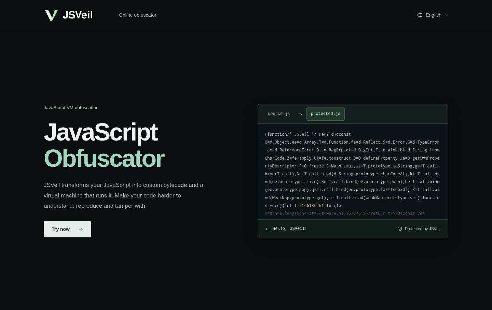
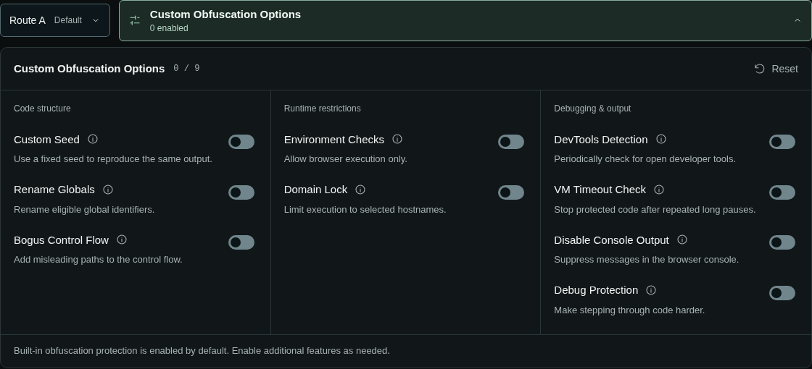

# JSVeil

**Free JavaScript Obfuscator · JavaScript VM Obfuscation**

**[Try it online →](https://jsveil.com/)**

JSVeil is a free online JavaScript obfuscator that uses **virtual-machine obfuscation** to make your code harder to understand, reproduce and tamper with.

Open the website, add your JavaScript and download the protected result. No installation or local build setup is required.

## What is JavaScript VM obfuscation?

JavaScript VM obfuscation translates protected logic into a custom bytecode format. A generated interpreter executes that bytecode when the resulting JavaScript runs.

This adds a layer between the visible code and the original program logic. Understanding the protected program involves understanding both its bytecode and the virtual machine that executes it.

## Why JSVeil?

- **Free to use.** Obfuscate JavaScript directly at [jsveil.com](https://jsveil.com/).
- **VM-based protection.** Protected logic runs as custom bytecode inside a generated virtual machine.
- **Fresh output by default.** Each obfuscation uses a random seed; choose a custom seed when you need repeatable output.
- **Configurable protection.** Built-in protection is enabled by default, with additional controls for code structure, runtime restrictions and debugging.
- **A practical online editor.** Paste code or open a file, inspect the output, then copy or download it. Your custom options are remembered between visits.
- **Seven languages.** English, Simplified Chinese, Traditional Chinese, German, French, Japanese and Russian.

## Get started

1. Open **[jsveil.com](https://jsveil.com/)**.
2. Paste your JavaScript or open a file.
3. Adjust **Custom Obfuscation Options** if needed.
4. Select **Obfuscate JavaScript** and complete verification.
5. Review the result in **Output**, then choose **Copy** or **Download**.

## Custom obfuscation options

Additional options are off by default, so you can choose the features that fit your project.

| Option | What it does |
| --- | --- |
| Custom Seed | Use a fixed seed for repeatable output with the same code, options and compiler version. |
| Rename Globals | Rename eligible global identifiers. |
| Bogus Control Flow | Add misleading branches to make the control flow harder to follow. |
| Environment Checks | Restrict execution to supported browser environments. |
| Domain Lock | Limit execution to selected hostnames, including wildcard subdomains. |
| DevTools Detection | Check for open developer tools while the protected code runs. |
| VM Timeout Check | Stop protected code after repeated long execution pauses. |
| Disable Console Output | Suppress console output. |
| Debug Protection | Add debugger traps, with an adjustable trigger interval. |

## Choose your language

[English](https://jsveil.com/) · [简体中文](https://jsveil.com/zh-cn/) · [繁體中文](https://jsveil.com/zh-tw/) · [Deutsch](https://jsveil.com/de/) · [Français](https://jsveil.com/fr/) · [日本語](https://jsveil.com/ja/) · [Русский](https://jsveil.com/ru/)

---

**[Try JSVeil for free →](https://jsveil.com/)**
